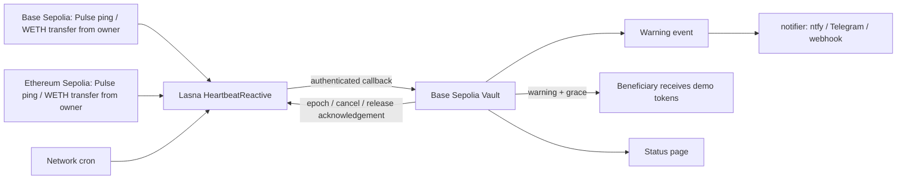

# Heartbeat

**Cross-chain activity, one inheritance policy.** A testnet dead-man switch for
demo ERC20 assets: if the owner goes quiet on every watched chain, a warning goes
out, and after a grace period the vault releases to the beneficiary. No keeper.

**Status page:** [boowenchen.github.io/reactive-heartbeat](https://boowenchen.github.io/reactive-heartbeat/) (live, reads the v2 deployment) · **Alerts:** `notifier/` pushes warnings to ntfy, Telegram or a Discord/Slack webhook.

## Problem and why Reactive

A wallet owner may be active on several chains while a vault sits on one chain.
That vault cannot read remote activity or wake itself up after silence. Heartbeat
uses Reactive subscriptions to combine the owner's activity on Base Sepolia and
Ethereum Sepolia — explicit pings **and ordinary transfers of tokens the owner
chooses** — plus network cron events that trigger warning and release callbacks.
This implementation needs no application-operated keeper. A separate off-chain
keeper could implement a similar policy; Reactive is essential to the chosen
on-chain event-driven execution model, not to the abstract idea.



## What counts as activity

- `Pulse.ping()` from the owner on any watched chain.
- An ERC20 `Transfer` **out of** the owner address with a non-zero amount, on token
  contracts the owner allowlists at deployment (this deployment: WETH on Base Sepolia
  and on Ethereum Sepolia). The allowlist matters: any contract can emit a
  Transfer-shaped log naming the owner, so only listed token contracts are trusted.
- Zero-value transfers are ignored: most tokens let anyone call `transferFrom(owner, x, 0)`
  without an allowance, which would otherwise let a stranger keep the vault alive.
- Incoming transfers never count; anyone can send tokens to the owner.

## Using it

- **Status page** (`app/`, served by GitHub Pages): state (Alive / Warning / Released /
  Cancelled), countdown to warning and release, beneficiary, vault balance, activity
  sources and a timeline with explorer links. With a browser wallet the owner can ping,
  cancel or reconfigure. Configure addresses in `app/config.json`.
- **Alerts** (`notifier/notify.mjs`, Node 18+, no dependencies): polls the vault and
  sends Warning, Released and settings changes to ntfy (`NTFY_URL`), Telegram
  (`TELEGRAM_BOT_TOKEN`, `TELEGRAM_CHAT_ID`) or a webhook (`WEBHOOK_URL`). Run it as a
  loop, a cron job or a small service; see `notifier/README.md`. Alerts are a
  convenience: release safety does not depend on them.

## Policy and controls

- Reactive stores the latest receipt timestamp per chain. Delayed or reordered activity
  postpones release. Block counts and assumed 200 ms intervals do not drive deadlines.
- One warning request per activity version. Release is requested only after
  `releaseAfter` of silence **and** `grace` (+30 s delivery margin) since the warning
  request; the warning is resent with each release attempt so a lost warning cannot
  block release forever.
- Heartbeat callbacks are throttled to one per quarter warning window, except right after
  a warning, when the next activity always clears it immediately.
- Owner changes/cancellation increment a destination epoch immediately; queued callbacks
  from an older policy are harmless. **Cancel also unsubscribes cron**, so a paused policy
  stops paying for ticks; reconfiguring resubscribes. The owner can recover principal
  after cancellation.
- The destination requires both the official callback proxy and this particular
  reactive contract address. Native callback gas cannot consume ERC20 principal.
- Release is terminal and idempotent. The release acknowledgement unsubscribes cron
  **and every activity source**. If that acknowledgement were lost, anyone can call
  `publishConfiguration()`; a same-epoch "inactive" configuration switches the
  reactive contract off.
- Unused funds: `withdraw` (Lasna, lREACT) and `withdrawGasFunds` (Base, native) are
  owner-only and only while the policy is inactive.

## Operating limits

This is a single-owner, single-beneficiary test-token prototype. It does not prove
death or make asynchronous delivery instantaneous. A remote ping not yet observed
cannot undo a release already executing on the destination; owners should use local
cancel for an immediate veto. Network delivery, fee funding and cross-chain ordering
remain part of the trust and liveness assumptions. Specific residual risks, found in a
pre-deployment review and documented by tests in `test/Review.t.sol`:

- A contract the owner has approved to spend a tracked token can keep the policy alive
  by moving those tokens. Track tokens you don't leave standing approvals on.
- If the first warning callback is lost and grace is long, release attempts are retried
  every cron tick until one grace after the resent warning; nothing is released early,
  but those retries cost callback fees.
- `status()`/`deadlines()` are destination-side estimates; they follow delivered
  heartbeats only.
- Running cost scales with the cron interval. This demo used Cron100 (~106 s on Lasna);
  a real policy measured in weeks would use Cron10000 (~3 h).

## Transaction evidence — v2 live loop (2026-11-08)

Policy: warn after 240 s, release after 480 s, grace 60 s, Lasna Cron100. Beneficiary is a
separate test wallet. Every row links origin → Lasna reactive transaction → Base callback.

| # | Stage | Origin | Lasna reactive | Base callback |
|---|---|---|---|---|
| 1 | Ordinary WETH transfer on Base counts as activity | [0xf27a8f10…d5ca](https://base-sepolia.blockscout.com/tx/0xf27a8f103d079cbb48846c9937dbd9a4ca5c1997166fb9624e5a8d9c1585d5ca) | [0x4435f549…08d4](https://lasna.reactscan.net/tx/0x4435f549e5050a9e1a7f1fe1502452c1017b41aababac82d5ac4cca721d508d4) | [0x9777cf7c…3f1d](https://base-sepolia.blockscout.com/tx/0x9777cf7c1dd8052ff5abbaaf0b02bef4ac9c485e2f564c122e8dc279155b3f1d) Heartbeat |
| 2 | Silence → Warning (alert pushed to ntfy) | Lasna cron [0xe1626c6f…0fe2](https://lasna.reactscan.net/tx/0xe1626c6ffc424008deaa0d072a097deddf8462e5ead960410cd71985e30c0fe2) | [0x58f54f52…69b9](https://lasna.reactscan.net/tx/0x58f54f524cce0050d5a22f0ee6ceeee6bfc162a7802b6fe020535880b77869b9) | [0x4c5ae3e1…7279](https://base-sepolia.blockscout.com/tx/0x4c5ae3e1008ac224ccfd7dbf30fd1641a5a3519ab1cbc06d56dbbc0147127279) Warning |
| 3 | Owner answers with a WETH transfer on Ethereum Sepolia → warning cleared | [0xd4a9deaa…2d83](https://eth-sepolia.blockscout.com/tx/0xd4a9deaa57d72fb03788aabe788b3729c0a2bd3377029b609364a57501f02d83) | [0xf889cf2e…8195](https://lasna.reactscan.net/tx/0xf889cf2e50a7b30c8fd88ada607cf1f787478bb168744e726ea510fef1a98195) | [0x3d3b2f6f…59d3](https://base-sepolia.blockscout.com/tx/0x3d3b2f6f53923a7b1b3ecb08ea34ea129ec96eeef7161699eb2b489b2e6959d3) Heartbeat |
| 4 | Owner cancels → reactive stops and unsubscribes cron | [0x5338da76…5df3](https://base-sepolia.blockscout.com/tx/0x5338da762dcdb36519c3e86f2e6aa9d3352fc8d189968c57ceff44fbfc555df3) | [0xe6217feb…25bb](https://lasna.reactscan.net/tx/0xe6217febe3a8b45e87f795fd1f3aff030a7fe91841b86a6aaaa7166f65d725bb) | — |
| 5 | Owner reconfigures (epoch 3) → cron resubscribed | [0x0ab4baa6…9fca](https://base-sepolia.blockscout.com/tx/0x0ab4baa69d8fc0e31b2fbb881d80271f72982724a1be3028005135d867eb9fca) | [0x7b79e695…40fb](https://lasna.reactscan.net/tx/0x7b79e69593dded9051a80c440b6470bdc21534415135464e324862726ec840fb) | — |
| 6 | Silence → Warning (epoch 3) | Lasna cron [0xfdc1541a…990c](https://lasna.reactscan.net/tx/0xfdc1541a60a357ef42f18598271dc8d2a276d74bdab268c5f2e8cd10de39990c) | [0x2a86f4a8…9096](https://lasna.reactscan.net/tx/0x2a86f4a8d46878aac14e3c4bc39667731f9acdee2d3f1799f352f7c1b4069096) | [0x685edb32…6759](https://base-sepolia.blockscout.com/tx/0x685edb323432b3202a80fc0f4d95ddd0eb85bf7d0d3cfef87955d99b634d6759) Warning |
| 7 | Release after 480 s silence + grace: 100 HBA to beneficiary | Lasna cron [0x34194bce…d8d2](https://lasna.reactscan.net/tx/0x34194bce3e9d8b73df415e522768c743a7b0ae000c07f3f1173ed03e3bccd8d2) | [0xa1bc5bf2…0eaf](https://lasna.reactscan.net/tx/0xa1bc5bf23e34e3e994641b097c45ae3544afa4c1c3eb930d429a007940ac0eaf) | [0x0bfa0c18…e6c0](https://base-sepolia.blockscout.com/tx/0x0bfa0c18011ed81a84e1896cd9b862b1af21f5494ff3fdba86734a2be752e6c0) Released |
| 8 | Release acknowledged → cron and all activity sources unsubscribed | [0x0bfa0c18…e6c0](https://base-sepolia.blockscout.com/tx/0x0bfa0c18011ed81a84e1896cd9b862b1af21f5494ff3fdba86734a2be752e6c0) | [0x69ebbc4e…e7a0](https://lasna.reactscan.net/tx/0x69ebbc4e8f92b7b77ba31edbfdf1c02247446fe029372c99cfc0720277dee7a0) | — |

Row 7's reactive transaction also resent the warning (idempotent; no second Warning
event). Read-back after the loop: Vault released=true, beneficiary
`0xC84B9212AfA279d94bCe0550a10105e17af2b40b` holds 100 HBA; Reactive released=true,
cronEnabled=false. Unused funds were then withdrawn by the owner: 0.33 lREACT
([0x0fd6e1ed…48b9](https://lasna.reactscan.net/tx/0x0fd6e1ed00b7102909bccf665821a69d48d792d9ab5916e0dbece35fd4dc48b9)) and 0.0019 ETH
([0x6761a234…9307](https://base-sepolia.blockscout.com/tx/0x6761a2346c1dde958ec843b2ffcd7f47a1e5f880f3e16e384abc0349d6f69307)). The whole
v2 loop (about 18 minutes active, 6 callbacks) consumed about 0.26 lREACT of the
reactive contract's funding and about 0.000005 ETH of callback fees on Base.

| Contract | Network | Address |
|---|---|---|
| HeartbeatReactive v2 | Lasna | [0xff70c3f9bce166fe0406d1cb74ed6c4b7fd292b6](https://lasna.reactscan.net/address/0xff70c3f9bce166fe0406d1cb74ed6c4b7fd292b6) |
| Vault v2 | Base Sepolia | [0xee32f101c3112220c6662585904622119fe60aca](https://base-sepolia.blockscout.com/address/0xee32f101c3112220c6662585904622119fe60aca) |
| Pulse (reused from v1) | Base Sepolia | [0x2327e84c823df7c0f4f1320401de104a4b6b1f61](https://base-sepolia.blockscout.com/address/0x2327e84c823df7c0f4f1320401de104a4b6b1f61) |
| Pulse (reused from v1) | Ethereum Sepolia | [0x8ad21bdc4d3c5ce687ce47be22d63a9bb7523912](https://eth-sepolia.blockscout.com/address/0x8ad21bdc4d3c5ce687ce47be22d63a9bb7523912) |
| Tracked token: WETH | Base Sepolia | `0x4200000000000000000000000000000000000006` |
| Tracked token: WETH | Ethereum Sepolia | `0xfFf9976782d46CC05630D1f6eBAb18b2324d6B14` |
| HBA demo asset (reused from v1) | Base Sepolia | [0x5d927759b821c6a1c72a65b91967de0e4d14bb65](https://base-sepolia.blockscout.com/address/0x5d927759b821c6a1c72a65b91967de0e4d14bb65) |

Machine evidence: [stages, decoded origins and vault events](evidence/heartbeat-v2-collected.json).

### Earlier v1 loop (2026-11-07, ping-only contracts)

Base Sepolia and Ethereum Sepolia only; Unichain was not used. Warning/release originate from Lasna Cron10, so their origin link is a real cron transaction. Silence has no fabricated origin transaction; it is evidenced by successive unchanged activity versions before Warning.

| Stage | Origin tx | Lasna reactive tx | Base callback tx |
|---|---|---|---|
| Heartbeat (v1) | [0x4d92ef8f4ed0516d1fc87c90be341909e50cff99d76e04737233af5513bf3307](https://sepolia.basescan.org/tx/0x4d92ef8f4ed0516d1fc87c90be341909e50cff99d76e04737233af5513bf3307) | [0x5cac9f9a165f68fb203f80b220cdd6d2d534dd22ad81401551365e6f9eb1dafd](https://lasna.reactscan.net/tx/0x5cac9f9a165f68fb203f80b220cdd6d2d534dd22ad81401551365e6f9eb1dafd) | [0x8ec80356baeb297f7fdb67ed3c18fd9f9dcec11ddd62f5104feddb08d814f418](https://sepolia.basescan.org/tx/0x8ec80356baeb297f7fdb67ed3c18fd9f9dcec11ddd62f5104feddb08d814f418) |
| Heartbeat (v2) | [0xf86dd97c38d5c09dc53c6bd4ac93bb5bbbb1dcdb3c5d393249f5c7b778e5a440](https://sepolia.etherscan.io/tx/0xf86dd97c38d5c09dc53c6bd4ac93bb5bbbb1dcdb3c5d393249f5c7b778e5a440) | [0x5ee5789a75a4bc636bce3088a4cf400d4f836c488e490d2761aa99ea29f2e839](https://lasna.reactscan.net/tx/0x5ee5789a75a4bc636bce3088a4cf400d4f836c488e490d2761aa99ea29f2e839) | [0x63c530f57449e0e1eb1e045b66e2715b0376535e20abdc3131607d7ed8b4ecf9](https://sepolia.basescan.org/tx/0x63c530f57449e0e1eb1e045b66e2715b0376535e20abdc3131607d7ed8b4ecf9) |
| Heartbeat (v3) | [0x1a3a3ced5e990a6016c59c6f69ed0fdb6286d31a00e29cb0ef0231d487b01aa9](https://sepolia.basescan.org/tx/0x1a3a3ced5e990a6016c59c6f69ed0fdb6286d31a00e29cb0ef0231d487b01aa9) | [0xb7fc598e90f05589c4cbe91a9d8b4dcbcb9ece32a9525b2f5fba86b4391a0225](https://lasna.reactscan.net/tx/0xb7fc598e90f05589c4cbe91a9d8b4dcbcb9ece32a9525b2f5fba86b4391a0225) | [0x77c6b1e68f94949af09f5ae65da416fe707280de43eb727e63934ae1522bdcb9](https://sepolia.basescan.org/tx/0x77c6b1e68f94949af09f5ae65da416fe707280de43eb727e63934ae1522bdcb9) |
| Warning (v3) | [0xb1553c64a6ec72de45cb2318c13bf64cd1a12e47ed80591db9ced39f4ef748ae](https://lasna.reactscan.net/tx/0xb1553c64a6ec72de45cb2318c13bf64cd1a12e47ed80591db9ced39f4ef748ae) | [0x46deeecf12c30774ac22f8e9e9ae531aea39a39799e96d5b51b1396515be5fba](https://lasna.reactscan.net/tx/0x46deeecf12c30774ac22f8e9e9ae531aea39a39799e96d5b51b1396515be5fba) | [0xae8326a116e07700d1d5edcc8cb4b5fbafcf3ffb9c2416bb5ef4f18f9e7c9b8f](https://sepolia.basescan.org/tx/0xae8326a116e07700d1d5edcc8cb4b5fbafcf3ffb9c2416bb5ef4f18f9e7c9b8f) |
| Released (v3) | [0x293412f2440c52b5df9a6395e8bc469fa33ad7c6d6f8369e67182b0802f92b0a](https://lasna.reactscan.net/tx/0x293412f2440c52b5df9a6395e8bc469fa33ad7c6d6f8369e67182b0802f92b0a) | [0x80801bb954c09bb52c3665fc2b9bb434a4789c2add07d6b97a674cc967cb33dc](https://lasna.reactscan.net/tx/0x80801bb954c09bb52c3665fc2b9bb434a4789c2add07d6b97a674cc967cb33dc) | [0xae95a2c790f834bd83887f329718d540ddc3d7d5cb09232068f5eb57b6b061b9](https://sepolia.basescan.org/tx/0xae95a2c790f834bd83887f329718d540ddc3d7d5cb09232068f5eb57b6b061b9) |

| Contract | Network | Address |
|---|---|---|
| BASE_PULSE | base | [0x2327e84c823df7c0f4f1320401de104a4b6b1f61](https://sepolia.basescan.org/address/0x2327e84c823df7c0f4f1320401de104a4b6b1f61) |
| SEPOLIA_PULSE | sepolia | [0x8ad21bdc4d3c5ce687ce47be22d63a9bb7523912](https://sepolia.etherscan.io/address/0x8ad21bdc4d3c5ce687ce47be22d63a9bb7523912) |
| REACTIVE | lasna | [0x2327e84c823df7c0f4f1320401de104a4b6b1f61](https://lasna.reactscan.net/address/0x2327e84c823df7c0f4f1320401de104a4b6b1f61) |
| TOKEN | base | [0x5d927759b821c6a1c72a65b91967de0e4d14bb65](https://sepolia.basescan.org/address/0x5d927759b821c6a1c72a65b91967de0e4d14bb65) |
| VAULT | base | [0x7509221859d2984ed941f671b616c6a77d07c95b](https://sepolia.basescan.org/address/0x7509221859d2984ed941f671b616c6a77d07c95b) |

Policy: warn after 120 s, release after 240 s, destination grace 45 s. Three pings advanced both activity versions to 1, 2, 3 while warnedAt stayed zero and released stayed false. After silence, Warning was emitted; release transferred **100 demo HBA** to the same dedicated test wallet. Vault token balance is zero, released=true, active=false; Reactive active=false and cronEnabled=false. This is one terminal release cycle, with three heartbeat subloops.

Native funds: 0.9 lREACT allocated to this Reactive contract in total; 0.3294136 lREACT remained after automatic cron shutdown. The v1 contract had no owner withdrawal method (added in v2). The Base callback contract was funded with 0.001 ETH. Machine evidence: [events and hashes](config/evidence.json), [state observations](evidence/heartbeat-loop.json), [raw receipts and source correlation](evidence/heartbeat-collected.json).

## Build and verification

Lasna release acknowledgement (automatic cron unsubscribe): [0x21aee27181ff8cbfbe097f5a73014ebfb11e8d386fb67f6307be725a48ccc1d4](https://lasna.reactscan.net/tx/0x21aee27181ff8cbfbe097f5a73014ebfb11e8d386fb67f6307be725a48ccc1d4). Its source transaction is the Released callback above; raw input and receipt are saved in [evidence/heartbeat-release-ack.json](evidence/heartbeat-release-ack.json).

```sh
python tools/bootstrap.py
forge test -vv
```

Windows: `./tools/test.ps1` finds user-local Foundry even when it is absent from PATH.
The build used existing Foundry 1.8.6 in the user's .foundry/bin (no installation or
Hardhat fallback needed), Solidity 0.8.30, optimizer and via-IR. Dependencies are pinned
by commit in `dependencies.lock.json`; each project is independent with no sibling imports.
See [TESTLOG.md](TESTLOG.md) for actual passing logs and a deliberately broken invariant.
The bounded two-origin deployment has been broadcast and live-tested. See
[DEPLOY.md](DEPLOY.md), [SOURCES.md](SOURCES.md) and [VIDEO-SCRIPT.md](VIDEO-SCRIPT.md).

Our source is MIT; upstream dependencies retain their terms (see SOURCES).
AI-assisted implementation; the live testnet acceptance evidence is recorded above. Self-review is not an independent security audit.
