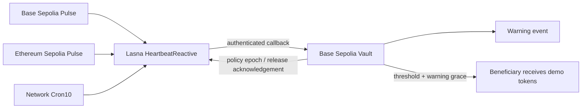

# Heartbeat

**Cross-chain activity, one inheritance policy.** A testnet dead-man switch for
demo ERC20 assets, with warning, grace and immediate owner cancellation.

## Problem and why Reactive

A wallet owner may be active on several chains while a vault sits on one chain.
That vault cannot read remote activity or wake itself up after silence. Heartbeat
uses Reactive subscriptions to combine authenticated pings from Base Sepolia
and Ethereum Sepolia, plus network cron events to trigger warning
and release callbacks. This implementation needs no application-operated keeper.
A separate off-chain keeper could implement a similar policy; Reactive is essential
to the chosen on-chain event-driven execution model, not to the abstract idea.



## Policy and controls

- Only the owner's explicit `Pulse.ping()` counts. This is an opt-in activity proxy,
  not automatic surveillance of every transaction or arbitrary token Transfer events.
- Reactive stores the latest receipt timestamp per chain. Delayed/reordered activity
  postpones release. Block counts and assumed 200 ms intervals do not drive deadlines.
- Owner changes/cancellation increment a destination epoch immediately. Queued callbacks
  from an older policy are harmless. The owner can recover principal after cancellation.
- The destination requires both the official callback proxy and this particular
  reactive contract address. Native callback gas cannot consume ERC20 principal.
- Release requires a warning for the current activity version, elapsed destination
  grace, and elapsed local reset threshold. Retries are idempotent; release is terminal.
- Callbacks are retried on cron ticks. A release acknowledgement disables cron; an
  unfinished/cancelled demo should explicitly unsubscribe to stop tick charges.

## Honest operating limits

This is a single-owner, single-beneficiary test-token prototype. It does not prove
death, monitor arbitrary wallet activity, support rebasing/fee-on-transfer assets,
or make asynchronous delivery instantaneous. A remote ping not yet observed cannot
undo a release already executing on the destination. Owners should use local cancel
for an immediate veto. Network delivery, fee funding, and cross-chain ordering remain
part of the system's trust and liveness assumptions. No UI is included in this version.

## Transaction evidence — verified testnet loop

Only **Base Sepolia and Ethereum Sepolia** are heartbeat origins in this deployment. Unichain was not used. Warning/release originate from Lasna Cron10, so their origin link is a real cron transaction. Silence has no fabricated origin transaction; it is evidenced by successive unchanged activity versions before Warning.

| Stage | Origin tx | Lasna reactive tx | Base callback tx |
|---|---|---|---|
| Heartbeat (v1) | [0x4d92ef8f4ed0516d1fc87c90be341909e50cff99d76e04737233af5513bf3307](https://sepolia.basescan.org/tx/0x4d92ef8f4ed0516d1fc87c90be341909e50cff99d76e04737233af5513bf3307) | [0x5cac9f9a165f68fb203f80b220cdd6d2d534dd22ad81401551365e6f9eb1dafd](https://lasna.reactscan.net/tx/0x5cac9f9a165f68fb203f80b220cdd6d2d534dd22ad81401551365e6f9eb1dafd) | [0x8ec80356baeb297f7fdb67ed3c18fd9f9dcec11ddd62f5104feddb08d814f418](https://sepolia.basescan.org/tx/0x8ec80356baeb297f7fdb67ed3c18fd9f9dcec11ddd62f5104feddb08d814f418) |
| Heartbeat (v2) | [0xf86dd97c38d5c09dc53c6bd4ac93bb5bbbb1dcdb3c5d393249f5c7b778e5a440](https://sepolia.etherscan.io/tx/0xf86dd97c38d5c09dc53c6bd4ac93bb5bbbb1dcdb3c5d393249f5c7b778e5a440) | [0x5ee5789a75a4bc636bce3088a4cf400d4f836c488e490d2761aa99ea29f2e839](https://lasna.reactscan.net/tx/0x5ee5789a75a4bc636bce3088a4cf400d4f836c488e490d2761aa99ea29f2e839) | [0x63c530f57449e0e1eb1e045b66e2715b0376535e20abdc3131607d7ed8b4ecf9](https://sepolia.basescan.org/tx/0x63c530f57449e0e1eb1e045b66e2715b0376535e20abdc3131607d7ed8b4ecf9) |
| Heartbeat (v3) | [0x1a3a3ced5e990a6016c59c6f69ed0fdb6286d31a00e29cb0ef0231d487b01aa9](https://sepolia.basescan.org/tx/0x1a3a3ced5e990a6016c59c6f69ed0fdb6286d31a00e29cb0ef0231d487b01aa9) | [0xb7fc598e90f05589c4cbe91a9d8b4dcbcb9ece32a9525b2f5fba86b4391a0225](https://lasna.reactscan.net/tx/0xb7fc598e90f05589c4cbe91a9d8b4dcbcb9ece32a9525b2f5fba86b4391a0225) | [0x77c6b1e68f94949af09f5ae65da416fe707280de43eb727e63934ae1522bdcb9](https://sepolia.basescan.org/tx/0x77c6b1e68f94949af09f5ae65da416fe707280de43eb727e63934ae1522bdcb9) |
| Warning (v3) | [0xb1553c64a6ec72de45cb2318c13bf64cd1a12e47ed80591db9ced39f4ef748ae](https://lasna.reactscan.net/tx/0xb1553c64a6ec72de45cb2318c13bf64cd1a12e47ed80591db9ced39f4ef748ae) | [0x46deeecf12c30774ac22f8e9e9ae531aea39a39799e96d5b51b1396515be5fba](https://lasna.reactscan.net/tx/0x46deeecf12c30774ac22f8e9e9ae531aea39a39799e96d5b51b1396515be5fba) | [0xae8326a116e07700d1d5edcc8cb4b5fbafcf3ffb9c2416bb5ef4f18f9e7c9b8f](https://sepolia.basescan.org/tx/0xae8326a116e07700d1d5edcc8cb4b5fbafcf3ffb9c2416bb5ef4f18f9e7c9b8f) |
| Released (v3) | [0x293412f2440c52b5df9a6395e8bc469fa33ad7c6d6f8369e67182b0802f92b0a](https://lasna.reactscan.net/tx/0x293412f2440c52b5df9a6395e8bc469fa33ad7c6d6f8369e67182b0802f92b0a) | [0x80801bb954c09bb52c3665fc2b9bb434a4789c2add07d6b97a674cc967cb33dc](https://lasna.reactscan.net/tx/0x80801bb954c09bb52c3665fc2b9bb434a4789c2add07d6b97a674cc967cb33dc) | [0xae95a2c790f834bd83887f329718d540ddc3d7d5cb09232068f5eb57b6b061b9](https://sepolia.basescan.org/tx/0xae95a2c790f834bd83887f329718d540ddc3d7d5cb09232068f5eb57b6b061b9) |

| Contract | Network | Address |
|---|---|---|
| BASE_PULSE | base | [0x2327e84c823df7c0f4f1320401de104a4b6b1f61](https://sepolia.basescan.org/address/0x2327e84c823df7c0f4f1320401de104a4b6b1f61) |
| SEPOLIA_PULSE | sepolia | [0x8ad21bdc4d3c5ce687ce47be22d63a9bb7523912](https://sepolia.etherscan.io/address/0x8ad21bdc4d3c5ce687ce47be22d63a9bb7523912) |
| REACTIVE | lasna | [0x2327e84c823df7c0f4f1320401de104a4b6b1f61](https://lasna.reactscan.net/address/0x2327e84c823df7c0f4f1320401de104a4b6b1f61) |
| TOKEN | base | [0x5d927759b821c6a1c72a65b91967de0e4d14bb65](https://sepolia.basescan.org/address/0x5d927759b821c6a1c72a65b91967de0e4d14bb65) |
| VAULT | base | [0x7509221859d2984ed941f671b616c6a77d07c95b](https://sepolia.basescan.org/address/0x7509221859d2984ed941f671b616c6a77d07c95b) |

Policy: warn after 120 s, release after 240 s, destination grace 45 s. Three pings advanced both activity versions to 1, 2, 3 while warnedAt stayed zero and released stayed false. After silence, Warning was emitted; release transferred **100 demo HBA** to the same dedicated test wallet. Vault token balance is zero, released=true, active=false; Reactive active=false and cronEnabled=false. This is one terminal release cycle, with three heartbeat subloops.

Native funds: 0.9 lREACT allocated to this Reactive contract in total; 0.3294136 lREACT remained after automatic cron shutdown. It has no owner withdrawal method. The Base callback contract was funded with 0.001 ETH. Machine evidence: [events and hashes](config/evidence.json), [state observations](evidence/heartbeat-loop.json), [raw receipts and source correlation](evidence/heartbeat-collected.json).

## Build and verification

Lasna release acknowledgement (automatic cron unsubscribe): [0x21aee27181ff8cbfbe097f5a73014ebfb11e8d386fb67f6307be725a48ccc1d4](https://lasna.reactscan.net/tx/0x21aee27181ff8cbfbe097f5a73014ebfb11e8d386fb67f6307be725a48ccc1d4). Its source transaction is the Released callback above; raw input and receipt are saved in `../evidence/heartbeat-release-ack.json`.

```sh
python tools/bootstrap.py
forge test -vv
```

Windows: `./tools/test.ps1` finds user-local Foundry even when it is absent from PATH.
The build used existing Foundry 1.8.6 in the user's .foundry/bin (no installation or
Hardhat fallback needed), Solidity 0.8.30, optimizer and via-IR. Dependencies are pinned
by commit in `dependencies.lock.json`; each project is independent with no sibling imports.
See [TESTLOG.md](TESTLOG.md) for actual passing logs and a deliberately broken invariant.
The bounded two-origin deployment has been broadcast and live-tested. See
[DEPLOY.md](DEPLOY.md), [SOURCES.md](SOURCES.md) and [VIDEO-SCRIPT.md](VIDEO-SCRIPT.md).

Our source is MIT; upstream dependencies retain their terms (see SOURCES).
AI-assisted implementation; the live testnet acceptance evidence is recorded above. Self-review is not an independent security audit.
